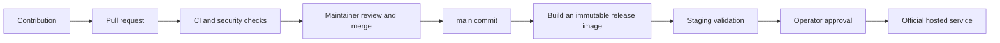

> Joinlet · Fonte: `docs/releases.md`. Projeção do arquivo do repositório. Alterações feitas aqui são preservadas para revisão; o arquivo original não é substituído.

# Contributions, releases and the official service

The source repository contains the Joinlet product. The operations repository contains procedures and deployment decisions, not a second application fork.

## Current behavior

Pushes and pull requests run application and publication/security checks. These workflows do not deploy, publish a container, copy secrets, contact production or automatically merge contributions. A merge alone does not update the official service.

The product is released as open source; operational materials remain private. The product's code license is AGPL-3.0-only; publication and source distribution must make the corresponding source accessible. The private operations repository and the old development repository must remain private.

## Accepting a contribution

Contributors submit pull requests against this product repository. Maintainers review behavior, authorization boundaries, tests, dependency changes, copied assets and licenses. Code ownership files signal sensitive paths; only enabled GitHub protection rules can make review/check requirements mandatory.

At minimum, require the `verify` and `publication` checks for `main`, prevent force pushes/deletion and require pull requests. A solo maintainer can require a pull request and checks while setting the independent approving-review count to zero; this is not a two-person review. External contributors still cannot merge without write permissions. With additional trusted maintainers, enable required independent/code-owner approvals. Availability of protections on private repositories depends on the GitHub plan.

Public contribution workflows use read-only credentials, pinned actions and no production secrets. Never connect untrusted pull requests to a deployment runner or use `pull_request_target` to execute contributor code with privileged credentials.

## Promoting code to a hosted release

Select a full reviewed commit reachable from `main` whose exact revision passed the required workflows. Create the Docker build context from `git archive <commit>` rather than the operator's working directory, so ignored/untracked `.env`, customer exports and personal files do not enter the build context. The archive does not replace secret scans of committed source.

Build once with `JOINLET_REVISION=<commit>`. Identify the resulting registry image by its immutable `@sha256:<digest>` and record source revision, CI runs, image digest and provenance in private release records. Labels identify a revision but do not independently prove how an image was built; verified build provenance/attestations are a separate release control.

Test that same image in staging with separate credentials, volume and GitHub application. Validate login, isolation of two accounts, sharing/revocation, WebSocket reconnection and backup/restore. An operator then approves production promotion using that same digest. Do not rebuild another image or select a mutable `latest`/`beta` tag during promotion.

Operational secrets, customer databases and backups stay outside both repositories. Keep data volumes and the encryption key across updates. Take a consistent backup before a migration. A code rollback does not automatically reverse a database migration; assess compatibility or restore a validated snapshot before reopening writes.

This sequence describes the release process to implement. The current workflows do not yet build/push release images or promote staging/production, and no hosting account or deployment credentials are configured by this document.
